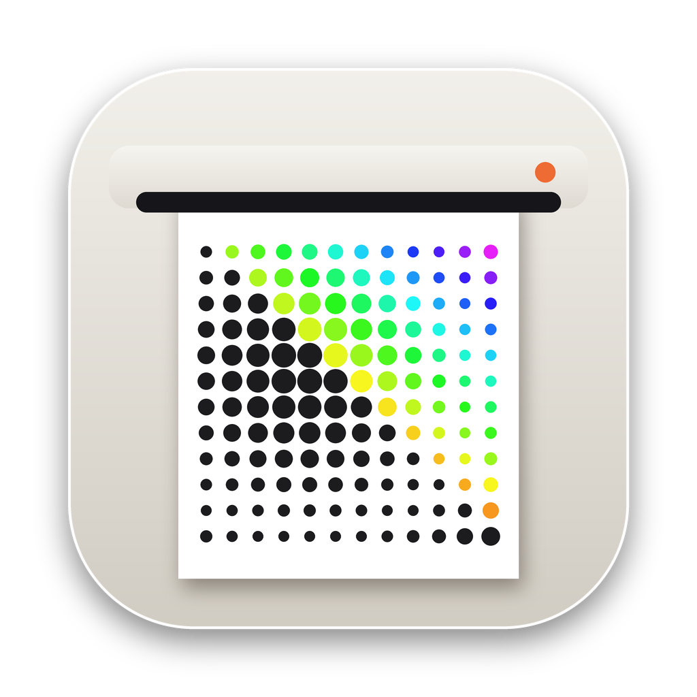
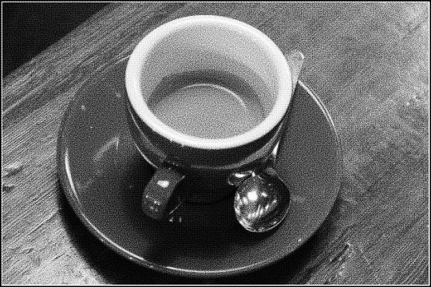
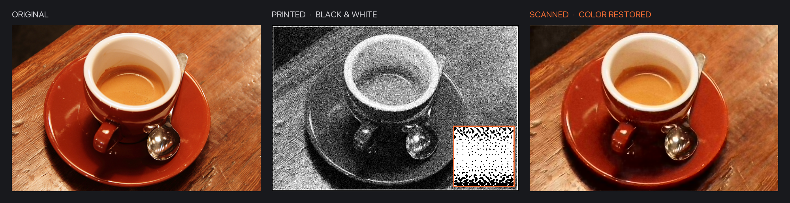
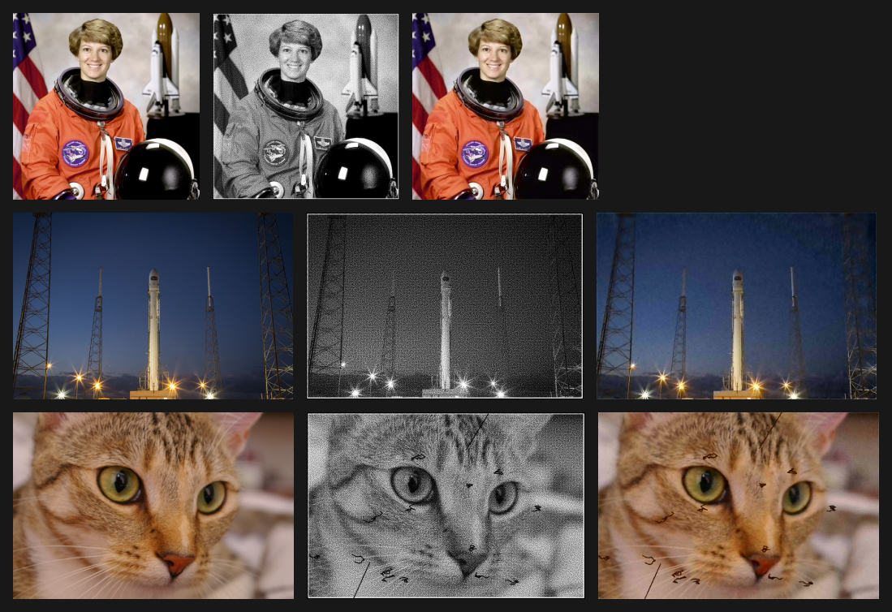
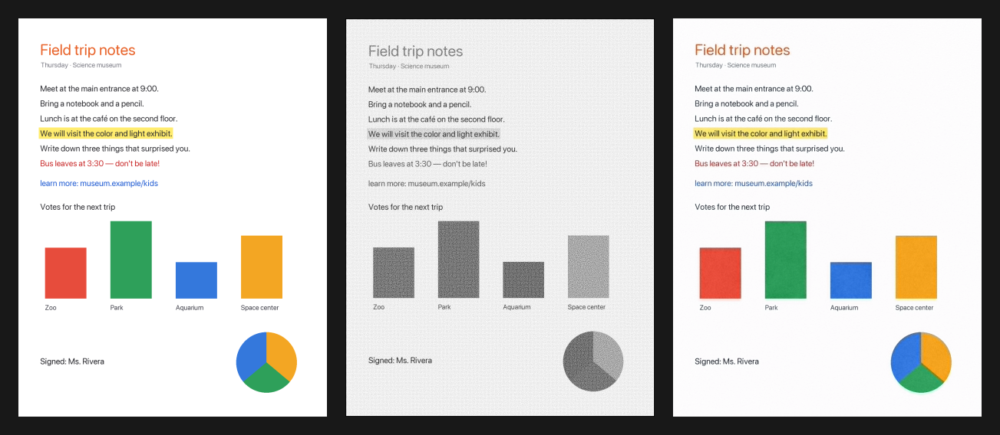
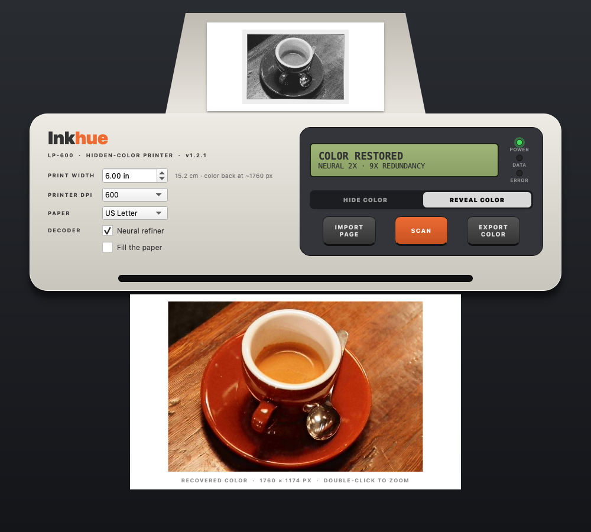
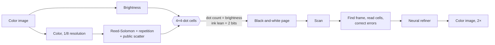

<div align="center">



# Inkhue

### A black-and-white print that carries its own color.

Print a color photo or document on **any black-and-white printer**. It looks like an ordinary grayscale page.<br>
Scan it, and Inkhue brings the color back.

[](https://github.com/TonyD365/Inkhue/releases/latest)
[](https://github.com/TonyD365/Inkhue/actions/workflows/ci.yml)
[](https://github.com/TonyD365/Inkhue/releases)
[](LICENSE)


[Download](#download) · [How to use](#how-to-use) · [How it works](#how-it-works) · [Benchmark](#benchmark) · [Wiki](https://github.com/TonyD365/Inkhue/wiki) · [中文说明](README.zh-CN.md)





<sub>Original · what gets printed (inset: the actual printer dots) · color recovered from the scan, at 2× resolution.</sub>

</div>

---

## What it is

- **Prints on any black-and-white printer.** The page is an ordinary-looking grayscale halftone.
- **The color is in the dots.** Which way the ink leans inside each tiny cell of printer dots stores the photo's
  color — for *every region* of the picture, aligned with it, not in a code in the corner.
- **Scan it back.** 600 dpi (400 at least) on any flatbed or multifunction printer. Inkhue finds the page, reads the
  dots, corrects errors and restores the color.
- **Open.** No key, no encryption, no account. The format is public and anyone can decode a page — "hidden" means
  hidden from the eye, not from people.

## Gallery

<div align="center"></div>

<sub>Original · printed · recovered. Bottom row: someone wrote on the printout with a pen — the color still comes back,
and the handwriting stays, just as it is on the paper.</sub>

<div align="center"></div>

<sub>Documents too: notes, worksheets and slides keep their highlights, colored text and charts.
Photos: public domain / CC0 (NASA, scikit-image).</sub>

## How to use

1. **Install** Inkhue for your system ([download](#download)).
2. **Hide color** — load a photo, image or PDF. Inkhue makes the black-and-white page, as large as fits on your paper.
3. **Print** it from Inkhue's print panel at **100 % scale** (the default).
4. **Reveal color** — scan the printout in grayscale at **600 dpi** (400 at least), straight from your scanner in
   Inkhue or by importing the scan. The color comes back; export it as PNG, JPEG, PDF and more.

Upside down, a little crooked, written on? All fine.

<div align="center"></div>

## Features

- 🖨️ **Printer-style app** for macOS, Windows and Linux
- 🎨 **Photos and documents** — mostly white pages work as well as photos
- 🧠 **Neural refiner** (small U-Net, CPU via ONNX Runtime) — removes grain, sharpens color, outputs **2× resolution**
- 🖨️ **Print panel with live preview** — every printer and driver option, Save as PDF, layout, paper, pages per sheet,
  margins, scale, two-sided, headers and footers; jobs go straight to the print system at 100 %
- 🔍 **Scan from the app** — ImageKit on macOS, WIA on Windows, SANE on Linux — or import a PDF / image
- ✍️ **Robust** — Reed-Solomon error correction and redundancy survive pen marks, smudges, tilt, upside-down scans;
  areas too damaged to correct stay gray instead of turning into random color
- 📐 **Fill the paper** — prints each photo as large as the paper allows
- 💾 **Export** the recovered photo as PDF, PNG, JPEG, TIFF, WebP, HEIC, JPEG 2000, BMP…
- 📦 **Real installers** and 🔄 **automatic updates**, verified by SHA-256

## Download

| Platform | Installer | Installs to |
|---|---|---|
| macOS (Apple silicon) | `Inkhue-vX.Y.Z-macos-arm64.pkg` | Applications |
| macOS (Intel) | `Inkhue-vX.Y.Z-macos-x64.pkg` | Applications |
| Windows 10/11 (64-bit) | `Inkhue-vX.Y.Z-windows-x64-setup.exe` | your programs folder (or Program Files for all users) |
| Ubuntu / Debian (x86-64) | `Inkhue-vX.Y.Z-linux-x64.deb` | `/opt/Inkhue`, app menu, `inkhue` command |

From the [latest release](https://github.com/TonyD365/Inkhue/releases/latest). Every file is listed in
`SHA256SUMS.txt` and carries a [build provenance attestation](https://docs.github.com/actions/security-for-github-actions/using-artifact-attestations)
(`gh attestation verify <file> -R TonyD365/Inkhue`).

<details>
<summary><b>First install: the installers aren't signed with a paid certificate</b></summary>

**macOS** — open the `.pkg`. The first time, macOS refuses it: **System Settings → Privacy & Security → Open
Anyway**, then follow the installer. Once only; updates install themselves without a password.

**Windows** — run the `setup.exe`. If SmartScreen appears: **More info → Run anyway**.

**Ubuntu / Debian** — `sudo apt install ./Inkhue-*.deb`. Scanning uses SANE: `sudo apt install sane-utils`.
</details>

More help: [installation](https://github.com/TonyD365/Inkhue/wiki/Installation) ·
[printing and scanning](https://github.com/TonyD365/Inkhue/wiki/Printing-and-Scanning) ·
[troubleshooting](https://github.com/TonyD365/Inkhue/wiki/Troubleshooting) · [FAQ](https://github.com/TonyD365/Inkhue/wiki/FAQ)

## How it works



| Part | What it does |
|---|---|
| **Data halftone** | Every pixel becomes a 4×4 cell of printer dots (1/150 inch at 600 dpi). *How many* dots are inked sets the brightness; *which corner* the ink leans towards carries 2 bits. Dots are placed where the full-resolution image is darkest, so edges stay sharp. Mostly white pages keep at least one faint dot per cell, so blank paper carries data too. |
| **Color payload** | Color at 1/8 resolution, 6 bits, Reed-Solomon protected and repeated across the page. A fixed public permutation spreads every byte over the sheet, so local damage never wipes out a region. |
| **Frame** | A thin border finds the page and corrects tilt and perspective; a timing track, measured by its spectrum, gives the grid size even at 400 dpi. |
| **Neural refiner** | A U-Net (~1 M parameters) trained on photos (DIV2K) and synthetic documents through a simulated printer and scanner. It reads the scan dot by dot and outputs color at 2× the cell resolution. |

**How it differs from QR codes and watermarks:** those store a few bytes to a few kilobytes, either next to the image
or as a faint signature inside it. Inkhue stores information **for every region of the picture** — about 5.6 KB of raw
capacity per square inch at 600 dpi — while the page itself stays a clear photograph.

## Benchmark

Every pull request is benchmarked against `main`: 4 public-domain photos and a text document × 3 seeds, through a
simulated printer and scanner ([`scripts/benchmark.py`](scripts/benchmark.py)). Current `main`:

| Condition | Decoded | Raw bit errors | ΔE neural | Detail (PSNR @2×) |
|---|---|---|---|---|
| ideal | 100 % | 8.4 % | 2.66 | 28.8 dB |
| typical | 100 % | 8.1 % | 2.52 | 29.2 dB |
| 600 dpi scan | 100 % | 7.8 % | 2.91 | 28.1 dB |
| 400 dpi scan | 100 % | 12.7 % | 3.25 | 27.1 dB |
| handwriting on the page | 100 % | 9.4 % | 3.31 | 22.9 dB |
| harsh (poor print + scan) | 80 % | 19.9 % | 6.65 | 21.9 dB |

ΔE is CIEDE2000 color error (≈2 is barely visible). These are simulations; real-world reports are the most valuable
contribution — see below.

## Tips

- Print at **100 % scale**, at the printer's native **600 dpi**, plain paper. Laser printers give the cleanest dots;
  turn off toner saving and photo enhancement.
- Scan in **grayscale at 600 dpi** (400 at least), sharpening and descreening off. Keep the whole black frame in the scan.
- Bigger prints come back sharper and tolerate more damage.

## Roadmap

- **Self-locating tiles** — a page can mix Inkhue images with ordinary text; each tile decodes on its own, damaged
  tiles simply stay black and white.
- **Document palette** — exact colors for thin colored text.
- **Large-cell mode** — scans at 150–300 dpi and, later, phone photos, trading resolution for convenience.
- **Real-printer calibration** from community print/scan reports.

## Build from source

```bash
git clone https://github.com/TonyD365/Inkhue && cd Inkhue
python3 -m venv .venv && .venv/bin/python -m pip install -r requirements-app.txt
.venv/bin/python -m inkhue                                   # the app
.venv/bin/python -m inkhue.cli encode photo.jpg page.png     # command line: encode / simulate / decode
```

Tests, benchmark, training the refiner and releasing: [Development](https://github.com/TonyD365/Inkhue/wiki/Development).

## Format stability

Pages printed today must still decode in ten years. The format constants — above all the scatter `SEED` — are frozen
and pinned by [`tests/test_format.py`](tests/test_format.py); every change since 1.0 has been backwards compatible.

## Related work

- R. L. de Queiroz, K. M. Braun. *Color to Gray and Back: Color Embedding Into Textured Gray Images.* IEEE TIP, 2006.
- M. Xia, X. Liu, T.-T. Wong. *Invertible Grayscale.* ACM TOG (SIGGRAPH Asia), 2018.
- M. Tancik, B. Mildenhall, R. Ng. *StegaStamp: Invisible Hyperlinks in Physical Photographs.* CVPR, 2020.
- E. Agustsson, R. Timofte. *NTIRE 2017 Challenge on Single Image Super-Resolution: Dataset and Study* (DIV2K).

## Contributing

The most useful thing you can do: **print a page and scan it**, then share the result with the
[🖨️ print / scan report](https://github.com/TonyD365/Inkhue/issues/new?template=print-scan-report.yml) template.
Code contributions: see [CONTRIBUTING.md](CONTRIBUTING.md). Questions and ideas:
[Discussions](https://github.com/TonyD365/Inkhue/discussions). Security: [SECURITY.md](SECURITY.md).

## License

[Apache-2.0](LICENSE) — free to use, modify and ship, including commercially. Published openly so the method stays
free for everyone. Inkhue was called ColorHide until version 1.1.
