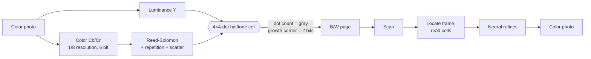

<div align="center">


# ColorHide

**Print a color photo as a plain-looking black-and-white page. Scan it, and the color comes back.**

[](https://github.com/TonyD365/ColorHide/releases/latest)
[](https://github.com/TonyD365/ColorHide/actions/workflows/ci.yml)
[](https://github.com/TonyD365/ColorHide/actions/workflows/release.yml)
[](https://github.com/TonyD365/ColorHide/releases)
[](LICENSE)


[Download](#download) · [How it works](#how-it-works) · [Printing tips](#printing-and-scanning-tips) · [Build from source](#build-from-source) · [中文说明](README.zh-CN.md)


<sub>Left: original. Middle: what gets printed (any black-and-white laser printer; inset: the actual dots). Right: color recovered from the scan at 2× resolution. In the app, double-click any sheet to zoom to full resolution.</sub>

</div>

---

## Why

Black-and-white printing is cheap and everywhere. Color is not. ColorHide stores a photo's color **inside the
microscopic arrangement of the printer dots**: to the eye the page is an ordinary grayscale halftone, but a scanner
can read the color back out. No secret key, nothing encrypted — the format is open and anyone can decode it.

<div align="center"></div>

## Features

- 🖨️ **Printer-style desktop app** for macOS, Windows and Linux
- 🎨 **Hide color** in a black-and-white page, **reveal color** from a scan
- 🖨️ **Built-in print panel with live preview** — destination (any printer, or Save as PDF), copies, layout,
  color, paper size, pages per sheet, margins, scale, two-sided, headers and footers, plus every option of the
  printer's own driver. Jobs go straight to the print system at 100 % scale
- 🔍 Scan straight from your **scanner or multifunction printer** (ImageKit on macOS, WIA on Windows, SANE on Linux), or import a PDF / image
- 💾 Export the recovered photo as **PDF, PNG, JPEG, TIFF, WebP, HEIC, JPEG 2000, BMP**…
- 🧠 Optional **neural refiner** (small U-Net, runs on CPU via ONNX Runtime) removes grain and sharpens color
- 🛡️ Reed-Solomon error correction + redundancy survive smudges, skew and scanner noise
- 📦 Real **installers**: `.pkg` into Applications on macOS, `setup.exe` on Windows, `.deb` on Ubuntu/Debian
- 🔄 **Auto-updates** from the latest GitHub release with the same installers, verified by SHA-256

## Download

| Platform | Installer | Installs to |
|---|---|---|
| macOS (Apple silicon) | `ColorHide-vX.Y.Z-macos-arm64.pkg` | `/Applications` |
| macOS (Intel) | `ColorHide-vX.Y.Z-macos-x64.pkg` | `/Applications` |
| Windows 10/11 (64-bit) | `ColorHide-vX.Y.Z-windows-x64-setup.exe` | your user's programs folder (or *Program Files* for all users), Start-menu entry, uninstaller |
| Ubuntu / Debian (x86-64) | `ColorHide-vX.Y.Z-linux-x64.deb` | `/opt/ColorHide`, app-menu entry, `colorhide` command |

Get them from the [latest release](https://github.com/TonyD365/ColorHide/releases/latest). Every file has a
SHA-256 in `SHA256SUMS.txt` and a [build provenance attestation](https://docs.github.com/actions/security-for-github-actions/using-artifact-attestations)
(`gh attestation verify <file> -R TonyD365/ColorHide`).

<details>
<summary><b>Installing: the installers are not code-signed by a paid certificate</b></summary>

**macOS** — open the `.pkg`. The first time, macOS refuses it: open **System Settings → Privacy & Security**,
scroll down, click **Open Anyway**, then follow the installer. ColorHide lands in **Applications**. You only do this
once; updates install by themselves, without a password.

**Windows** — run the `setup.exe`. If SmartScreen appears, click **More info → Run anyway**. No administrator rights
needed unless you choose to install for all users.

**Ubuntu / Debian** — `sudo apt install ./ColorHide-*.deb` (or double-click it). Then start *ColorHide* from the app
menu or run `colorhide`. Scanning uses SANE (`sudo apt install sane-utils`); updates ask for your password.
</details>

## How it works



| Layer | What it does |
|---|---|
| **Data halftone** | Every pixel becomes a 4×4 cell of printer dots (1/150 inch at 600 dpi). *How many* dots are inked sets the gray level; *which corner* the ink leans towards carries 2 bits. Inside each cell the dots are placed where the full-resolution photo is darkest, so edges stay sharp, while the ink's centre of mass still leans clearly enough towards the data corner. The eye only sees gray. |
| **Color payload** | Cb/Cr at 1/8 resolution, 6-bit, protected by Reed-Solomon and repeated across the page. A fixed, public permutation spreads every byte over the whole sheet so local damage never destroys a region. |
| **Neural refiner** | A small U-Net (≈1 M parameters) trained on [DIV2K](https://data.vision.ee.ethz.ch/cvl/DIV2K/) through a simulated print/scan channel. It reads the scan dot by dot — including the detail the halftone placed inside each cell — and outputs color at **2× the cell resolution** (300 ppi for a 600 dpi print), removing grain, correcting toner spread and sharpening the color along luminance edges. |
| **Frame** | A thin border to find the page in a scan and a timing track to count the grid. |

## Benchmark

Every pull request is benchmarked against `main`: 4 public-domain photos × 3 seeds, through a simulated printer
and scanner under four conditions ([`scripts/benchmark.py`](scripts/benchmark.py)). Current `main`:

Print sharpness (SSIM of the page as the eye sees it vs. the photo): **0.242** · neural output: **2× cell resolution**

| Condition | Decoded | Raw bit errors | ΔE classic | ΔE neural | Detail (PSNR @2×) |
|---|---|---|---|---|---|
| ideal | 100 % | 4.3 % | 2.81 | 2.98 | 29.1 dB |
| typical | 100 % | 9.3 % | 5.54 | 3.01 | 28.9 dB |
| 600 dpi scan | 92 % | 9.5 % | 4.70 | 3.07 | 28.6 dB |
| harsh | 33 % | 23.3 % | 13.00 | 8.20 | 20.3 dB |

ΔE is CIEDE2000 color error (≈2 is barely visible). Improving *harsh* and *600 dpi scan* is the open challenge —
PRs welcome.

## Printing and scanning tips

- Print at the printer's **native resolution (600 dpi)** and **100 % scale** — turn off *Fit to page* and any photo enhancement.
  Laser printers work best.
- Scan in **grayscale at 1200 dpi** (at least 900), with sharpening and descreening off.
- Keep the black frame fully inside the scan.

## Build from source

```bash
git clone https://github.com/TonyD365/ColorHide && cd ColorHide
python3 -m venv .venv && .venv/bin/pip install -r requirements-app.txt
.venv/bin/python -m colorhide            # the app
```

Command line:

```bash
python -m colorhide.cli encode photo.jpg page.png --width-in 6      # hide
python -m colorhide.cli simulate page.png scan.png                  # software print + scan
python -m colorhide.cli decode scan.png color.png                   # reveal
```

Train the refiner (uses Apple GPU / CUDA if available):

```bash
pip install -r requirements.txt
python scripts/make_dataset.py data/div2k/DIV2K_valid_HR --crops 24 --size 128
python scripts/train.py --steps 4000
python -m colorhide.refiner_onnx models/refiner.pt models/refiner.onnx
```

Package the app: `pyinstaller packaging/ColorHide.spec`. Releases are built by
[GitHub Actions](.github/workflows/release.yml) whenever a release is published; the tag (`v1.2.3`) is the version.

## Format stability

Pages printed today must still decode in ten years. The constants in
[`colorhide/payload.py`](colorhide/payload.py) — above all `SEED` — are frozen and pinned by
[`tests/test_format.py`](tests/test_format.py). Any change to the on-paper format needs a new `VERSION` and a decoder
that still reads the old one.

## Related work

- R. L. de Queiroz, K. M. Braun. *Color to Gray and Back: Color Embedding Into Textured Gray Images.* IEEE TIP, 2006.
- M. Xia, X. Liu, T.-T. Wong. *Invertible Grayscale.* ACM TOG (SIGGRAPH Asia), 2018.
- M. Tancik, B. Mildenhall, R. Ng. *StegaStamp: Invisible Hyperlinks in Physical Photographs.* CVPR, 2020.
- E. Agustsson, R. Timofte. *NTIRE 2017 Challenge on Single Image Super-Resolution: Dataset and Study* (DIV2K).

## Contributing

Issues and pull requests are welcome — especially **real-world print/scan results**
([report template](https://github.com/TonyD365/ColorHide/issues/new?template=print-scan-report.yml)).
See [CONTRIBUTING.md](CONTRIBUTING.md); security issues go through [SECURITY.md](SECURITY.md).

## License

[Apache-2.0](LICENSE). Free to use, modify and ship, including commercially. Published openly so that the method stays
free for everyone.
